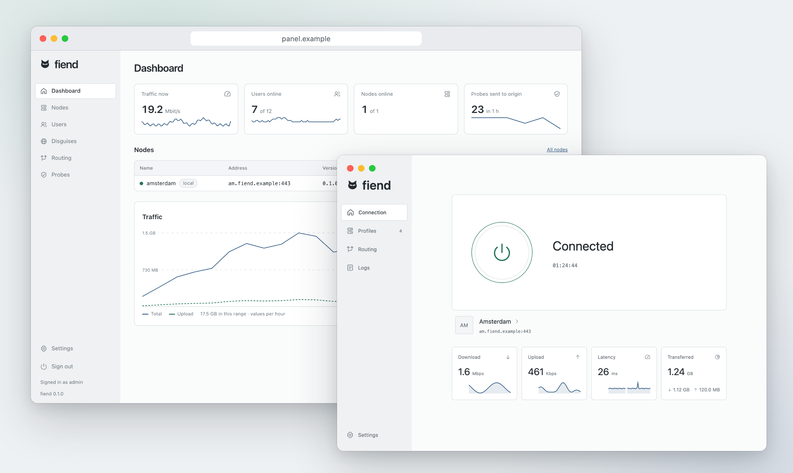

# Fiend

An experimental stealth VPN tunnel named after [_The Fiend with Twenty Faces_](https://en.wikipedia.org/wiki/The_Fiend_with_Twenty_Faces) by Edogawa Ranpo, a master of disguise.

<picture>
  <source media="(prefers-color-scheme: dark)" srcset="docs/images/hero-dark.png">
  
</picture>

## Features

### Server

One Docker image for amd64 and arm64 with the node and a web panel.

- Users with traffic limits, expiry and periodic resets, `fiend://` links and QR codes
- Disguises from ClientHello captures of any TLS client
- Node routing: direct, block, SOCKS5, HTTP, another Fiend server, Cloudflare WARP
- Log of failed probes
- Works behind nginx or a different TLS proxy on port 443, with the PROXY protocol
- Several admins, two-factor sign-in, audit log, backups

### Apps

Native apps for Android, macOS, Windows and Linux, plus a CLI.

- Profiles from `fiend://` links and QR codes
- Several servers per profile with failover
- Routing rules: direct, block, proxy
- DPI bypass without the tunnel: direct connections send the ClientHello as two TLS records in three TCP segments, cut inside the site name, and QUIC to these sites is dropped so apps fall back to TCP
- Rule lists by URL, including sing-box `.srs`
- Per-app split tunneling on Android
- Root mode on Android with a KernelSU or Magisk module: TPROXY instead of the Android VPN
- Encrypted backups on desktop

## Install

- [Server](docs/install/server.md)
- [Apps](docs/install/apps.md)
- [ClientHello capture](docs/capture.md)

## How it works

Filters can't read encrypted traffic, so they look at its shape. Fiend takes the shape from any TLS 1.3 client and its server: a mobile app and its API, an official app of a bank or a marketplace, an OS update or telemetry service, a smart TV or another IoT device and its cloud, or a browser.

A scanner can also check whether the SNI matches the server's IP address, and a bank's domain on a rented VPS stands out. So the best disguise, though not a required one, is a service that really runs on the same server, captured from any client that talks to it: an Android app, a script, a device.

The client sends a ClientHello captured from that client. Only the per-connection fields change: random, session ID, key shares, GREASE and the like. Any capture with SNI, a key share and a 32-byte session ID works.

On start, the server probes the original server from the capture and answers with the same cipher, key exchange, extension order and record sizes.

The session ID carries an HMAC of the client random and the current hour, keyed with the shared secret. Connections without a valid one, replays included, go to the original server, so probes get its real replies and certificate.

Inside the TLS 1.3 records runs an HTTP/2 session that carries TCP and UDP traffic. Keys come from the shared secret and an X25519 or X25519MLKEM768 exchange, and data is encrypted with AES-256-GCM.

## License

[PolyForm Noncommercial 1.0.0](LICENSE). Commercial use needs a separate license.
